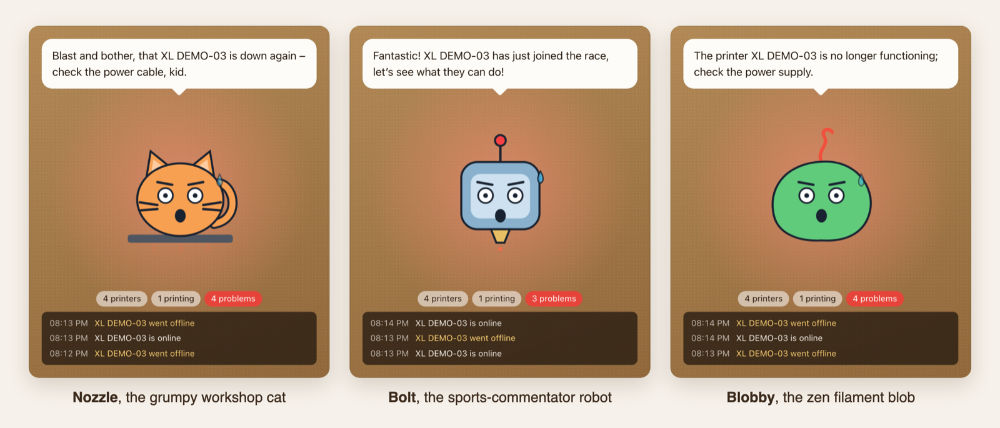
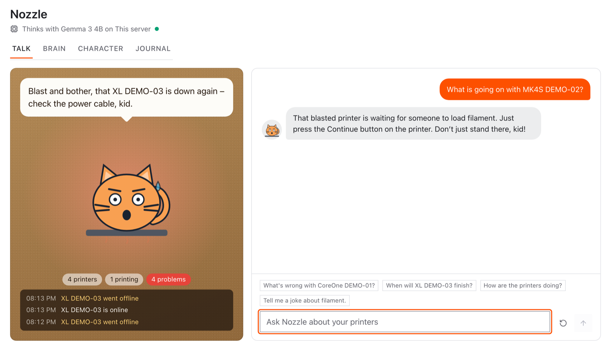

# PrintAIgotchi



A pet that lives in your [Prusa Connect](https://github.com/prusa3d/prusa-connect) server. It watches
the printers, tells you what needs you, comments on what happens in its own
words, and talks with you. Its brain is a small language model that runs on the
same machine as the server, a Raspberry Pi included, so nothing leaves your
network. It can also use any server that speaks the OpenAI chat API, such as
Ollama.

- **five characters**: grumpy workshop master, panicking intern, zen monk,
  sports commentator, cat on the heated bed
- **three looks**: a cat, a robot with a nozzle, a filament blob. The face
  follows the printers: alarmed, worried, busy, proud, sleepy, bored
- **eight languages** for what it says, and English and Czech for the page
- ten brains: a local model, Ollama, LM Studio, Claude, OpenAI, Gemini,
  OpenRouter, Groq, Mistral or any OpenAI-compatible server
- **it gets hungry**: printing feeds it. After a day without a print it begs, after two it
  starves, dramatically
- **it grows up** with the printing hours of the whole fleet: hatchling, youngster, grown-up,
  legend with a crown
- **a morning roast** of the day before, in its own character
- a page of its own with the chat, and a card for a dashboard



## How it works

| part | file | what it does |
| --- | --- | --- |
| eyes | `fleet.go` | follows the fleet on the server's event stream as the module itself (`observe`), turns changes into notices, works out the mood, and writes the plain-text picture of the fleet a model reads |
| brain | `brain.go`, `models.go` | downloads a pinned llama.cpp build and a pinned model into the module's data directory, checks both against a SHA-256 digest, and runs `llama-server` on a unix socket in a private directory, so it listens on no port |
| voice | `llm.go`, `anthropic.go` | one streaming client for the OpenAI chat API, and Claude through the Anthropic SDK |
| mind | `providers.go`, `mind.go` | the providers, the brain a person chose, and the routes of the Brain tab |
| body | `vitals.go`, `life.go` | hunger, growth and the day's counts, worked out from the clock and the fleet; the morning roast |
| character | `persona.go` | the characters and the character instructions the model reads |
| routes | `app.go` | the routes the page calls. An answer is started with `POST /chat` and read with `GET /chat/{id}` while the model writes it, because a model on a Raspberry Pi can take longer than one request may |

A person sees only the printers they may see: the picture a model reads and
the notices on the page are both read from the server as that person. The
conversation is kept in the browser, not on the server.

## Brains

A person picks the brain on the pet's page, on the Brain tab. The operator's
settings are where it starts, and `page_setup: false` keeps it there.

| provider | where it runs | client |
| --- | --- | --- |
| This server | a pinned llama.cpp and a model from the table below, on the server | OpenAI chat API on 127.0.0.1 |
| Ollama, LM Studio, another server | a computer in your network, at an address you enter | OpenAI chat API |
| Claude | Anthropic | the official Anthropic Go SDK, streaming, low effort, server-side refusal fallback on the models that take it |
| OpenAI, Gemini, OpenRouter, Groq, Mistral | the provider's cloud | OpenAI chat API |

**Test connection** lists the provider's models, so a person picks one from a
list instead of typing its name. Keys are kept in the module's record store,
one per provider, and the page only learns whether one is set.

### Local models

| key | model | download | memory | languages |
| --- | --- | --- | --- | --- |
| `qwen2.5-0.5b` | Qwen2.5 0.5B Instruct Q4_K_M | 0.5 GB | estimated 1.1 GB | English |
| `gemma3-1b` | Gemma 3 1B Q4_K_M | 0.8 GB | estimated 1.4 GB | many |
| `qwen2.5-1.5b` | Qwen2.5 1.5B Instruct Q4_K_M | 1.1 GB | measured 1.42 GB | English |
| `qwen3-1.7b` | Qwen3 1.7B Q8_0 | 1.8 GB | measured 2.47 GB | many |
| `gemma3-4b` (default) | Gemma 3 4B Q4_K_M | 2.5 GB | measured 3.03 GB | many |
| `qwen3-4b` | Qwen3 4B Q4_K_M | 2.5 GB | estimated 3.1 GB | many |
| `qwen3-8b` | Qwen3 8B Q4_K_M | 5.0 GB | estimated 5.6 GB | many |

Memory was measured on macOS arm64 while the model answers; nothing is
measured on a Raspberry Pi yet. The module asks for 3.5 GB, which fits every
model up to 4B; the page says when a model needs the operator to raise it.

Every model is pinned to a commit of its publisher's repository and to its
SHA-256. The Qwen models are Apache-2.0, the Gemma models are under the Gemma
Terms of Use. Asked in Czech, Gemma 3 4B answers in Czech and in character;
Gemma 3 1B and Qwen2.5 slip into English or nonsense.

The pinned llama.cpp build is `b12329`. Its Linux builds need glibc 2.38 or
newer, which Raspberry Pi OS on Debian 13 has. On an older system, set
`llama_server` to a build of your own, or use another provider.

## Settings

| key | default | what it does |
| --- | --- | --- |
| `provider` | `local` | where the pet thinks at first |
| `model` | `gemma3-4b` | the local model it starts with |
| `base_url`, `api_key`, `remote_model` | empty | the preset for a remote `provider` |
| `page_setup` | `true` | a person with operate rights may change the brain on the page |
| `llama_server` | empty | the path of a `llama-server` already on the machine |
| `threads` | `0` | CPU threads for the local brain, 0 lets it choose |
| `quips` | `true` | the pet comments on each new notice |
| `roast_hour` | `8` | the hour from which the pet writes its morning roast of the day before, -1 for none |

## Build and run it

Needs Go (the version in `go.mod`), Node 22.12+ and pnpm (`corepack enable`).

```bash
make check     # Go vet and tests, the UI's lint, types and build
make release   # release/: module.yaml, ui/, one binary per platform
make install   # installs release/ into bin/try with Prusa Connect's own `module add`
```

To work on the page with a dev server in front of a demo core:

```bash
cd .core && go run ./cmd/new-module -start demo -dir ..
```

Open the PrintAIgotchi page, choose a brain on the Brain tab, and talk to it.

Until the Prusa Connect SDK and the `@prusa` npm packages are published, both halves build against
a checkout of [Prusa Connect](https://github.com/prusa3d/prusa-connect) at `CORE_REF` (Makefile),
which `make` clones into `.core/`.

## Publish

Publishing a GitHub release tagged `v<version>` (the `version` in `module.yaml`) runs
`.github/workflows/release.yml`, which hands the commit to the
[marketplace's builder](https://github.com/prusa3d/prusa-connect-marketplace-publish). It builds,
signs and uploads the release, and the
[Prusa Plugin Marketplace](https://plugin-marketplace.prusa3d.com/connect) reviews it.

## License

MIT, see `LICENSE`.
